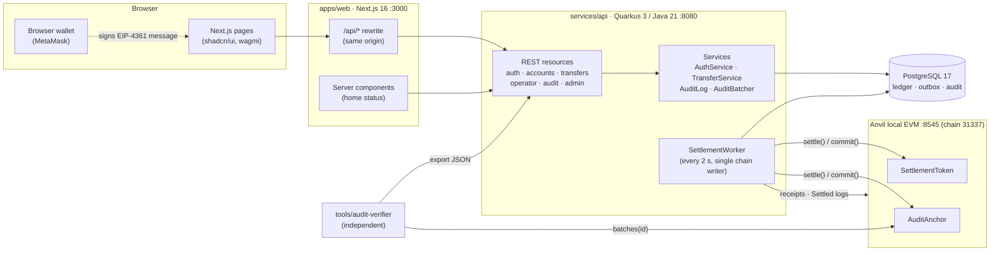
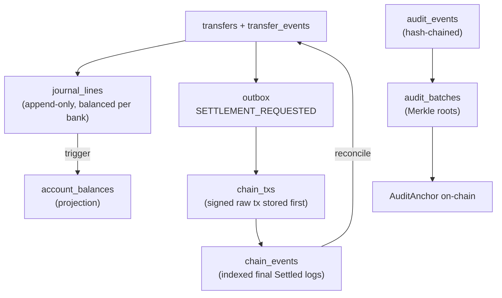
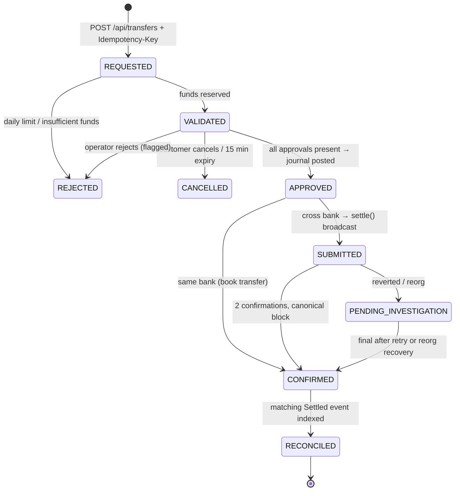
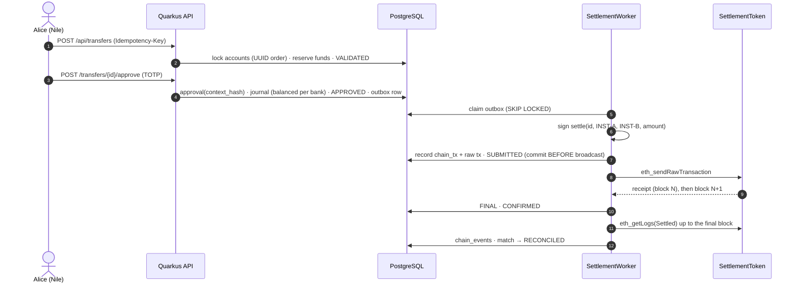
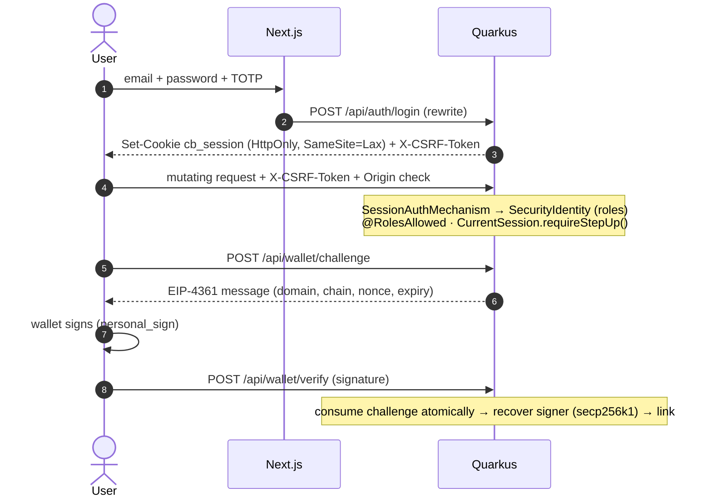
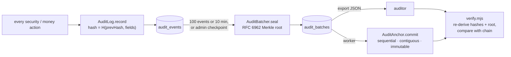

# Architecture

How ChainBank fits together, and how one transfer travels through it. The *why* behind each decision is in the [ADRs](adr/); this page is the map.

> Simulation only. The money, banks, customers and tokens are all fictional.

## 1. System context

| Part | Responsible for | Not responsible for |
|---|---|---|
| **Browser** | UI and wallet signatures (the private key never leaves the wallet) | It never holds API keys or chain keys, and never calls the API cross-origin |
| **Next.js** | Pages, plus proxying `/api/*` so session cookies are first-party | Business rules |
| **Quarkus API** | Authentication, authorization, limits, the transfer state machine, the outbox, settlement, reconciliation, audit | Being the source of truth for balances: that's the database ledger |
| **PostgreSQL** | **The bank's books.** It enforces the ledger invariants itself with triggers | |
| **Chain** | A public, verifiable record of interbank settlement and audit commitments | Customer balances, or any personal data |
| **Audit verifier** | Checking an exported audit batch against the chain without trusting the bank | |

## 2. Where the truth lives

- **Balances** come only from `journal_lines`. A trigger keeps `account_balances` in step and rejects overdrafts. The chain is never consulted for a customer balance (spec §8.1).
- **Settlement tokens** on the chain mirror each bank's SETTLEMENT account. Reconciliation proves the two agree ([ADR 0006](adr/0006-onchain-settlement.md)).
- **The audit log** is hash-chained in the database and committed to the chain in batches ([ADR 0007](adr/0007-audit-commitments.md)).

## 3. One transfer, end to end

Cross-bank, in time order:

The guarantees and where they come from:

| Guarantee | Mechanism | Code |
|---|---|---|
| No overdraft under concurrency | Ordered account locks, a conditional reservation, and a DB trigger | `TransferService.lockAccounts`, `reserve`, V1 trigger |
| Retries never move money twice | `UNIQUE(initiated_by, idempotency_key)` plus a request fingerprint | `TransferService.create` |
| Books always balance | Commit-time trigger: debits = credits, overall **and per bank** | V1, V4 `journal_balanced_check` |
| An approval authorises only its own transfer | `context_hash` over id, accounts, amount and expiry | `TransferService.contextHash` |
| A crash never loses or duplicates a settlement | Record then broadcast, rebroadcast, and a contract duplicate guard | `SettlementWorker`, `SettlementToken.settle` |
| Reorgs and reverts are surfaced | `PENDING_INVESTIGATION` plus reconciliation exceptions | `SettlementWorker.onReorg/onRevert` |

## 4. Identity and sessions

Details: [ADR 0002](adr/0002-primary-authentication.md) and [ADR 0004](adr/0004-sessions-csrf-and-wallet-linking.md). Roles: `CUSTOMER`, `BANK_OPERATOR`, `COMPLIANCE_REVIEWER`, `SYSTEM_ADMIN`, `AUDITOR` (spec §4).

## 5. Audit anchoring

## 6. Code map

| Concern | Location |
|---|---|
| Schema and invariants | `services/api/src/main/resources/db/migration/V1…V6` |
| Auth, sessions, CSRF, TOTP | `services/api/.../auth/` |
| Wallet linking (EIP-4361, secp256k1) | `.../wallet/` |
| Accounts and postings | `.../ledger/` |
| Transfers, approvals, operator review | `.../transfer/` |
| Chain client, settlement worker, reconciliation | `.../chain/` |
| Audit log, batches, Merkle, verification | `.../audit/` |
| Contracts | `contracts/contracts/*.sol` |
| Web pages | `apps/web/src/app/**/page.tsx` |
| Independent verifier | `tools/audit-verifier/verify.mjs` |
| Local stack | `infra/docker-compose.yml`, `Makefile` |
